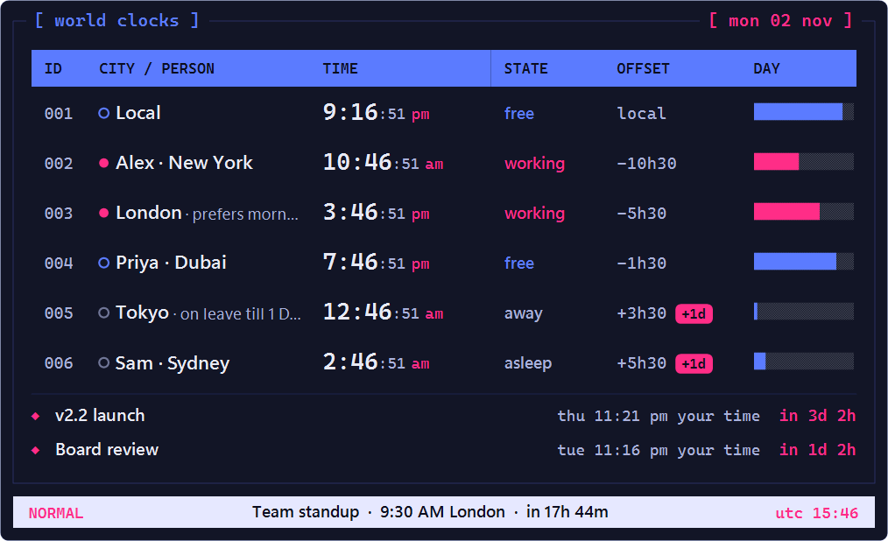
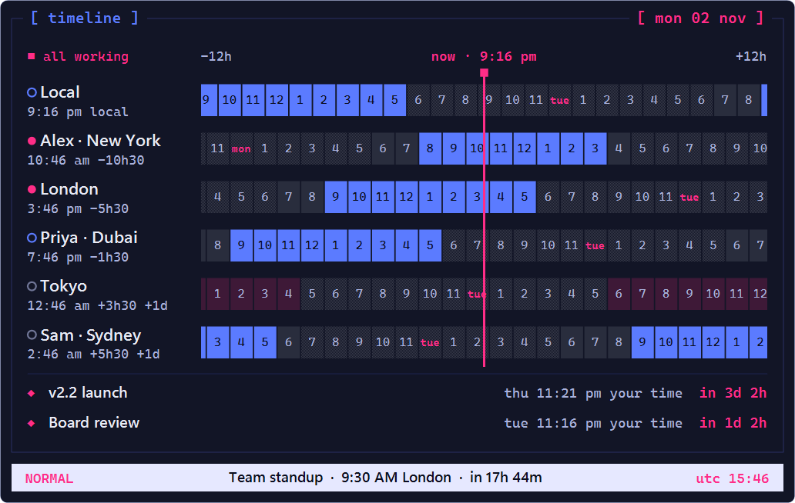
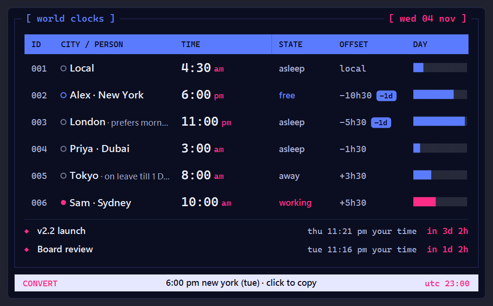
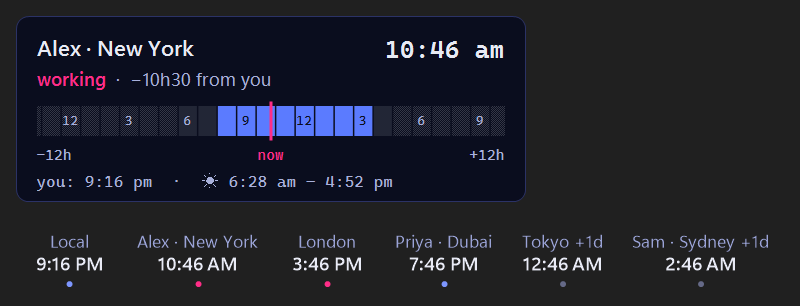
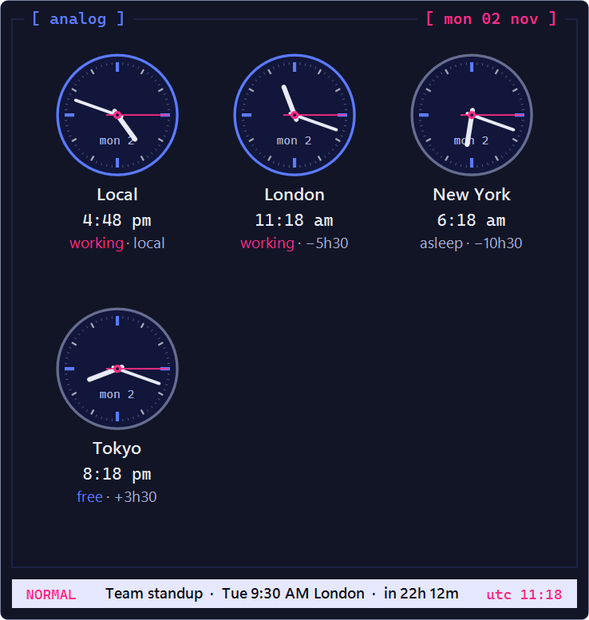
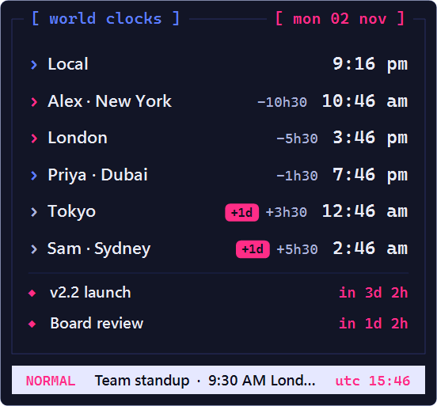
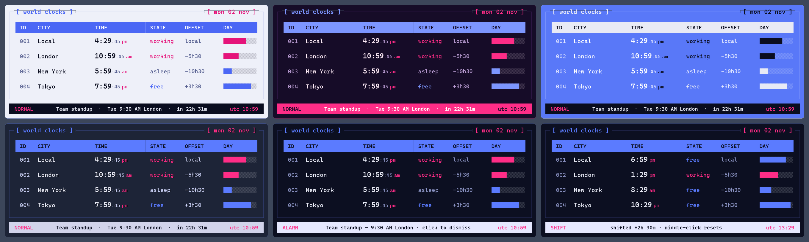

# WinClock

World clocks for your Windows desktop and taskbar. Tiny, fast, and terminal-styled.



## Install

1. Download **[WinClock-Setup.exe](https://github.com/whileTrueFalse/WinClock/releases/latest/download/WinClock-Setup.exe)**.
2. Run it and click **Install**. No admin rights are needed.
3. Done. Your clocks appear on the desktop and next to the taskbar clock.

> Windows may show "Windows protected your PC" because the app isn't code-signed yet. Click **More info → Run anyway**.

To uninstall, go to **Settings → Apps → WinClock → Uninstall**.

## How to use

**Right-click any clock** to open the menu. Everything lives there.

| To… | Do this |
|---|---|
| Add cities or teammates | Menu → **Add clocks / countries…**, or **Settings → Clocks & people** |
| Do anything quickly | **Ctrl + Alt + K** opens the command palette (try `3pm est thu`, `add Tokyo`, `theme paper`) |
| Convert between places | Press **Ctrl + Alt + K** and type e.g. `9pm in india, what time in germany` or `3pm london to tokyo` |
| Do time maths | `9pm IST + 3h 45m`, `how long until 6pm london`, `hours between 9am ny and 5pm tokyo`, `9am-5pm india in germany` |
| Focus, stopwatch, reminders | Menu → **Tools** (or type `focus`, `stopwatch`, `remind flight 6:40am frankfurt 3h before`) |
| Map, markets, weather | Menu → **Show** |
| Convert a time you copied | Copy text like "Tue 3pm PST", then press **Ctrl + Alt + V** |
| Plan a meeting | Scroll over the clocks to move time, or Menu → **Plan** for the fairness check and meeting card |
| Move the taskbar clocks | Menu → **Taskbar → Position** (left, right or drag) |
| Change settings | Menu → **Settings…** |
| Show or hide the widget | **Ctrl + Alt + W** |
| Change a shortcut | **Settings → General → Keyboard shortcuts** |

## Features

**Clocks**
- Four layouts (table, analog, timeline, compact) on the desktop, the taskbar and in a pop-up
- All your clocks on the taskbar, on every monitor; hover one for a 24-hour peek
- Live tray icon that can show the time of any clock
- Sunrise and sunset for each city; clear "+1 day" / "−1 day" markers

**People**
- Add teammates with their own working hours and days off
- A dot shows whether it's safe to message them now
- Public holidays for 17 countries, built in and offline
- Out-of-office dates and short notes

**Planning**
- Time calculator: type "9pm in India, what time in Germany?" and get the answer for 60+ countries and 130+ cities
- Command palette and clipboard time converter
- Meeting card you can copy or save as a calendar invite (.ics)
- Fairness check: finds the slot that's least painful for everyone over the next 4 weeks
- Pin important moments with a countdown
- Daylight-saving warnings before clocks change

**New in 2.5**
- Time maths in the calculator: durations, countdowns and working-hours overlap; ↑ brings back your last questions
- Pin an answer to the widget as a card; copy any time as a message for WhatsApp, Slack or email
- Focus timer (pomodoro) and stopwatch, shown live on the taskbar
- Leave-by reminders: "alert me 3 h before my 6:40 AM Frankfurt flight"
- Day/night world map, stock-market hours (NSE, NYSE, LSE, Tokyo and more), optional weather, moon phase and prayer times
- Travel mode: when your PC's time zone changes, keep a "Home" clock in one click
- Mini one-line strip, size presets, your own theme colours (or your Windows accent), and English / हिन्दी / Deutsch / Español
- Speak instead of typing: click the mic in the command palette (Windows voice typing)

**More**
- Next meeting from your calendar (.ics link) with a join reminder (off by default)
- Work / Personal profiles that can switch by time of day
- Share your setup with a short code
- Checks for updates when it starts and updates itself in one click (turn off in Settings)
- Follows Windows high contrast and text size
- Very light: one small app, a few MB of memory, near-zero CPU

<details>
<summary>More screenshots</summary>








</details>

## Build from source

You need [MSYS2](https://www.msys2.org/) or [w64devkit](https://github.com/skeeto/w64devkit) on Windows (or `mingw-w64` on Linux).

```bat
cd src
build.bat
```

To build the installer, put `WinClock.exe` in `installer\` and run `makensis installer\winclock.nsi` ([NSIS](https://nsis.sourceforge.io)).

Holiday dates for lunar and Islamic holidays are approximate. You can add or correct dates in `WinClock.ini` under `[Holidays]`, e.g. `IN=2027-10-29 Diwali`.

Releases are automatic: raise the number in `VERSION` and push to `main`. GitHub then builds the app and installer and publishes a new release.

Each release also includes **WinClock-Store.msix** for the Microsoft Store; see [docs/STORE.md](docs/STORE.md). It also includes ready-made [winget](https://learn.microsoft.com/windows/package-manager/) manifests. To publish to winget, submit them as a pull request to [microsoft/winget-pkgs](https://github.com/microsoft/winget-pkgs).
